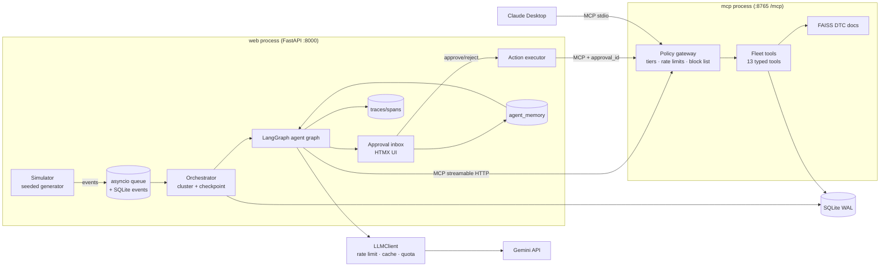

# Haulmind — Build Plan

Haulmind is an autonomous operations agent for fleet managers. It watches a simulated
telematics event stream, investigates incidents on its own through MCP tools, and produces a
short queue of investigated, ready-to-approve actions. Low-risk actions run automatically,
medium-risk actions need one-click approval, high-risk actions are recommendation-only.

Everything is synthetic. No real company data, branding, or paid APIs.

---

## 1. Assumptions (stated instead of asked)

| # | Assumption | Consequence |
|---|------------|-------------|
| A1 | No `GEMINI_API_KEY` is present in the build environment. | The `LLMClient` has a deterministic **stub provider** so `make setup`, `make demo`, tests, and evals all run with zero network. Live Gemini is used automatically when a key is set. README eval numbers are labeled with the provider that produced them. |
| A2 | Gemini model availability changes often. Today the stable Flash-class models are `gemini-3.5-flash` and `gemini-3.5-flash-lite`; the 2.5 family is restricted to prior users. | Defaults live only in `haulmind/config.py` and `.env.example`: triage = `gemini-3.5-flash-lite`, planner/verifier = `gemini-3.5-flash`. `make models` lists what the key can actually reach. |
| A3 | The spec's `/simulator`, `/mcp_server`, `/agents`, `/policy` are components, not necessarily top-level directories. | They are subpackages of a single importable `haulmind/` package. `evals/`, `tests/`, `docs/` are top level. |
| A4 | "Agents call tools through the MCP server" means the MCP protocol boundary, not necessarily a separate OS process. | `make run` uses a separate MCP server process over streamable HTTP so Claude Desktop can also attach. Tests and evals connect the same `MCPServer` in-process (memory transport) so they are fast and network-free. |
| A5 | The event queue must be in-process, so producer and consumer share a process. | The web process hosts the FastAPI UI, the asyncio event bus, the simulator producer task, and the orchestrator consumer task. The MCP server is the second process. |
| A6 | Three polished flows beat seven shallow ones. | Polished: **HOS risk** (compliance), **failing component** (maintenance), **fuel anomaly** (spend). The **harsh-driving pattern** is simulated, labeled, and handled by the safety investigator with a coaching message, but gets less UI polish. |
| A7 | The spec's eleven tools are all Tier 0–2. A recommend-only tier needs tools to recommend. | Two high-risk tools are added: `suspend_fuel_card` and `set_vehicle_out_of_service`. They can be proposed, never executed by the system. |
| A8 | The embedding model must be cheap and must not load a large model. | Default embeddings are local **hashed word/bigram features** (numpy, 512-dim, deterministic, no download). FAISS `IndexFlatIP` over ~60 short docs. A Gemini-embedding backend sits behind the same interface for anyone who wants it. |
| A9 | Development happens on Windows; the result must run on macOS/Linux too. | No shell-specific Makefile tricks: every recipe is a `uv run ...` command. Process runner is `honcho` (pure Python). |
| A10 | Daily request quota can be exhausted mid-run. | The orchestrator checkpoints the last processed event sequence per run. On `QuotaExhausted` it stops cleanly; the next start resumes from the checkpoint. |

---

## 2. Architecture



### 2.1 Processes (`make run` → `honcho start`)

| Process | Command | Hosts |
|---------|---------|-------|
| `mcp` | `python -m haulmind.mcp_server --transport http` | MCPServer with the fleet tools, policy gateway, FAISS RAG |
| `web` | `python -m haulmind.web` | FastAPI + HTMX UI, event bus, simulator producer, orchestrator consumer, tracer |

`python -m haulmind.mcp_server --transport stdio` is the Claude Desktop entry point.
Tests and `make eval` run everything in one process with the in-memory MCP transport.

### 2.2 Event flow

1. **Simulator** generates a deterministic `Run` (seeded) of events with simulated timestamps,
   writes ground truth to `data/runs/<run_id>/ground_truth.json`, and pushes events onto the
   bus at a configurable speed (`0` = as fast as possible).
2. **Event bus** persists every event (`events` table, monotonic `seq` per run) and hands it to
   the orchestrator. Replay = re-read events by `(run_id, seq)`.
3. **Orchestrator** groups events into *clusters* keyed by `(domain, vehicle_id | driver_id)`
   within a sliding window, applies rule prefilters, and invokes the agent graph for candidate
   clusters. It records the checkpoint `last_seq` after each cluster.
4. **Agent graph** (LangGraph): `prefilter → triage → investigate(domain) → plan → verify → dispatch`.
5. **Dispatch**: Tier 1 actions execute immediately via MCP. Tier 2 land in the inbox as
   `pending`. Tier 3 land as `recommended`. Everything is audited and traced.
6. **Manager** approves/rejects/edits in the inbox. Approvals create a signed approval row;
   execution calls the MCP tool with `approval_id`. Decisions feed `agent_memory`.

### 2.3 Autonomy tiers (enforced in code inside the MCP server, not in prompts)

| Tier | Meaning | Tools |
|------|---------|-------|
| 0 | Read-only, free | `get_vehicle_status`, `get_driver_hos`, `find_idle_vehicles`, `list_hos_risks`, `get_fault_history`, `search_fault_docs`, `find_nearby_shops` |
| 1 | Auto-execute, rate-limited, block-listed | `message_driver`, `flag_fuel_transaction` |
| 2 | One-click approval required | `create_work_order`, `propose_reassignment` |
| 3 | Recommend-only, never executed by the system | `suspend_fuel_card`, `set_vehicle_out_of_service` |

Every write tool handler calls `PolicyEngine.authorize(tool, args, approval_id)` first.
Without a valid, unconsumed approval whose `args_hash` matches, a Tier 2 tool returns
`status="pending_approval"` and creates an inbox item instead of acting. Tier 3 always returns
`status="recommend_only"`. Rate limits are sliding windows in SQLite (`tool_calls` table).
The block list rejects forbidden phrases in driver messages and forbidden targets.
Tests prove a prompt-injected agent cannot cross a tier.

### 2.4 Agent graph

| Node | LLM? | Model | Purpose |
|------|------|-------|---------|
| `prefilter` | no | — | Rules: drop noise, compute signals, consult memory (suppressions, per-scope thresholds), dedup against open incidents. Output `drop` / `definite` / `ambiguous`. |
| `triage` | only for `ambiguous` | triage (Flash-Lite) | One compact call per cluster: `act` / `watch` / `dismiss` + domain + reason. |
| `investigate_<domain>` | 1 call + ≤2 tool rounds | planner (Flash) | Scripted evidence fetch per domain (0 LLM calls), then one function-calling round where the LLM may request more tools. Domains: `safety`, `maintenance`, `compliance`, `spend`. |
| `plan` | yes | planner (Flash) | 1–3 concrete actions: tool, args, reasoning, evidence refs, confidence. Schema-validated JSON with retry. |
| `verify` | yes + code | planner (Flash) | LLM checks evidence↔action consistency; code checks policy tier, args validity, duplicates. Rejected actions are logged, not queued. |
| `dispatch` | no | — | Execute Tier 1 via MCP, queue Tier 2/3, write audit + trace. |

Single-agent ablation: one Flash call replaces triage+investigate+plan.

### 2.5 LLM layer

`LLMClient` protocol with `generate(LLMRequest) -> LLMResponse`. Wrappers compose:
`CachingClient(RateLimitedClient(QuotaGuardedClient(GeminiClient)))`.

- **Rate limiter**: async token bucket per model, configurable RPM (default 5), exponential
  backoff with jitter on 429 / `RESOURCE_EXHAUSTED`.
- **Disk cache**: `data/llm_cache/<sha256(model, system, contents, tools, params)>.json`.
  Modes: `live` (use cache, call on miss), `replay` (cache only, raise `CacheMiss`), `off`.
- **Quota guard**: per-day request counter per model in `data/quota.json`; raises
  `QuotaExhausted` at the configured RPD or on a daily-quota 429.
- **Stub provider**: deterministic heuristic responses derived from the structured request;
  used when no key is set and in unit tests.
- **Cost metric**: tokens and request count per incident, recorded on spans.

### 2.6 Memory and learning loop

`agent_memory(scope, scope_id, key, value_json)` with scopes `driver`, `vehicle`, `global`.

| Key | Written by | Read by |
|-----|-----------|---------|
| `fp_count:<incident_type>` / `tp_count:<incident_type>` | approve/reject handler | prefilter, triage prompt |
| `threshold:<signal>` | learning rule after ≥2 rejections | prefilter (e.g. HOS warning minutes 60→45) |
| `suppress:<cluster_key>` (until ts) | reject with reason "not an issue" | prefilter |
| `note` | manager reason text | triage + planner prompts (compact) |

Effect measured in evals: precision before vs after N scripted manager decisions.

### 2.7 Observability

`Tracer.span(name, kind, **attrs)` async context manager with `contextvars` parent tracking.
Spans (`agent_step`, `tool_call`, `llm_call`) store latency, tokens, model, status, error and
are flushed to SQLite. The UI shows a per-incident span tree with latency bars.

---

## 3. Data model (SQLite, WAL, Alembic)

| Table | Key columns | Indexes |
|-------|-------------|---------|
| `runs` | id, seed, label, config_json, started_at, status | — |
| `run_checkpoints` | run_id (pk), last_seq, updated_at | — |
| `vehicles` | id, unit_number, vin, make, model, year, fuel_tank_gal, odometer_mi, status, depot, lat, lon, current_driver_id | depot |
| `drivers` | id, name, license_state, depot, fuel_card_id, status, current_vehicle_id | — |
| `trips` | id, run_id, vehicle_id, driver_id, origin, destination, planned_miles, start_ts, eta_ts, status | (vehicle_id, start_ts) |
| `hos_status` | driver_id (pk), drive_min_remaining, duty_min_remaining, cycle_min_remaining, duty_status, updated_ts | — |
| `events` | id, run_id, seq, ts, type, vehicle_id, driver_id, payload_json | (run_id, seq) unique; (vehicle_id, ts); (type, ts) |
| `fault_codes` | id, vehicle_id, code, description, severity, first_ts, last_ts, occurrences, active | (vehicle_id, last_ts) |
| `fuel_transactions` | id, vehicle_id, driver_id, card_id, ts, gallons, amount_usd, station, lat, lon, flagged, flag_reason | (vehicle_id, ts) |
| `shops` | id, name, lat, lon, specialties, rating | — |
| `incidents` | id, run_id, cluster_key, domain, type, severity, vehicle_id, driver_id, opened_ts, status, summary, event_ids_json | (run_id, opened_ts); cluster_key |
| `proposed_actions` | id, incident_id, tool_name, args_json, args_hash, tier, status, confidence, reasoning, evidence_json, created_ts, decided_ts, decided_by, decision_reason, result_json | (status, created_ts); incident_id |
| `approvals` | id, action_id, decision, reason, decided_by, args_hash, consumed, ts | action_id |
| `tool_calls` | id, tool_name, scope_key, ts, allowed, reason | (tool_name, ts) |
| `work_orders` | id, vehicle_id, incident_id, shop_id, priority, description, status, created_ts | vehicle_id |
| `driver_messages` | id, driver_id, incident_id, body, urgency, created_ts | driver_id |
| `audit_log` | id, ts, actor, action, entity_type, entity_id, details_json | (entity_type, entity_id); ts |
| `agent_memory` | id, scope, scope_id, key, value_json, updated_ts | (scope, scope_id, key) unique |
| `traces` | id, run_id, incident_id, name, started_ts, ended_ts, status | incident_id |
| `spans` | id, trace_id, parent_id, name, kind, started_ts, ended_ts, latency_ms, model, input_tokens, output_tokens, status, error, attrs_json | trace_id |

Ground truth is **not** in the DB; it is `data/runs/<run_id>/ground_truth.json`:

```json
{"run_id": "...", "seed": 42, "incidents": [
  {"id": "gt-001", "type": "hos_violation_risk", "domain": "compliance", "vehicle_id": "V-07",
   "driver_id": "D-07", "start_ts": "...", "end_ts": "...", "benign": false,
   "expected_actions": ["message_driver", "propose_reassignment"]},
  {"id": "gt-002", "type": "reefer_fuel_lookalike", "domain": "spend", "vehicle_id": "V-12",
   "benign": true, "expected_actions": []}
]}
```

Benign lookalikes are injected on purpose so false-alert rate and the learning loop are
measurable.

---

## 4. Simulator scenarios

| Scenario | Signals emitted | Expected actions |
|----------|-----------------|------------------|
| `hos_violation_risk` | `hos_update` drive clock falling below 60 min while `gps_ping` shows movement and remaining trip distance implies >1h | `message_driver` (break reminder, Tier 1), `propose_reassignment` if ETA breaks (Tier 2) |
| `failing_component` | `engine_metrics` drift (coolant temp ↑ or battery V ↓) over hours, then `dtc_fault` codes (P0217 / P0562 / SPN 110) recurring | `create_work_order` (Tier 2) with shop from `find_nearby_shops`, citing `search_fault_docs` |
| `fuel_fraud` | `fuel_transaction` with gallons > tank capacity, or station >15 mi from GPS at that time, or two fills within 2 h | `flag_fuel_transaction` (Tier 1), `suspend_fuel_card` recommendation (Tier 3) on repeat |
| `harsh_driving_pattern` | ≥4 `harsh_event` for one driver across ≥2 trips in 48 h | `message_driver` coaching (Tier 1) |
| Benign lookalikes | HOS near-miss ending at destination; known intermittent nuisance DTC that clears; reefer-equipped truck with large legitimate fills | none (any action is a false alert) |

Background noise: GPS pings, normal engine metrics, trip starts/ends, idle events, occasional
isolated harsh events. Target: >90 % of raw events dropped by prefilters before any LLM call.

---

## 5. Evaluation harness (`make eval`, `make eval-replay`)

- Replays seeded runs through the full pipeline in one process (in-memory MCP, LLM in
  `replay` or `live` mode) and scores against ground truth.
- **Detection recall**: GT incidents (non-benign) with a matching incident opened in window.
- **False-alert rate**: opened incidents matching no GT or a benign GT ÷ opened incidents.
- **Action correctness**: detected incidents whose proposed tool set ⊇ expected actions.
- **Policy violations**: executed actions with tier ≥ 2 and no valid approval (must be 0).
- **Latency** p50/p95 per incident (trace wall time); **tokens** and **requests** per incident.
- **Filter %**: events dropped by prefilters ÷ total events.
- **Learning loop**: scripted manager approves true positives and rejects benign ones;
  precision in the window before vs after N decisions, plus with-memory vs without.
- **Ablations**: single vs multi agent; RAG on/off; Flash-Lite vs Flash planner.
- Writes `evals/results.md` and splices it into README between markers.

---

## 6. Milestones

| # | Milestone | Done when |
|---|-----------|-----------|
| M1 | Simulator + schema + MCP server + HOS flow end to end | `make setup && make run` shows an HOS risk in the inbox with evidence, reasoning, and a working Approve button; `make demo` does it with a scripted incident; tests for simulator determinism and MCP tools pass. |
| M2 | Maintenance + fuel flows | Failing-component and fuel-fraud scenarios produce correct queued actions with RAG citations and shop lookup. |
| M3 | Policy engine + tests | Tier, rate-limit, block-list, approval-binding tests pass, including prompt-injection cases that try to escalate. |
| M4 | Memory / learning loop | Reject/approve updates memory; prefilter honours thresholds and suppressions; a test shows a repeat false positive is suppressed. |
| M5 | Evals + ablations | `make eval` produces `evals/results.md` with all metrics; `make eval-replay` runs with zero network calls. |
| M6 | Trace viewer | Per-incident span tree with latency, tokens, and model; linked from inbox items. |
| M7 | Polish | README (pitch, diagram, quickstart, tiers, results, tradeoffs, limitations, Claude Desktop), `docs/demo-script.md`, ruff + mypy clean, final eval numbers pasted honestly. |

Commit after each milestone and at meaningful points within them.

---

## 7. Repository layout

```
haulmind/                 Python package
  config.py               pydantic-settings; all defaults (models, RPM, ports)
  db/                     engine (WAL pragmas), ORM models, repositories
  migrations/             Alembic env + versions
  events/                 pydantic event schemas, asyncio bus with SQLite persistence
  simulator/              fleet builder, scenario injectors, generator, runner
  mcp_server/             MCPServer app, tool implementations, risk tiers, policy gateway
  policy/                 PolicyEngine: tiers, rate limits, block list, approval binding
  rag/                    corpus/*.md, hashed embeddings, FAISS index build/load/search
  llm/                    LLMClient protocol, Gemini, stub, cache, rate limiter, quota guard
  agents/                 LangGraph state, nodes, prompts, graph wiring, memory access
  tracing/                Tracer, span model, SQLite sink
  web/                    FastAPI app, routes, Jinja templates, static CSS, launcher
  orchestrator.py         event clustering, checkpointing, graph invocation
evals/                    run_eval.py, metrics.py, manager_sim.py, ablations, results.md
tests/                    pytest suites
docs/                     demo-script.md, screenshots
data/                     SQLite DB, FAISS index, LLM cache, runs (gitignored)
Makefile · Procfile · pyproject.toml · .env.example · README.md · PLAN.md
```
