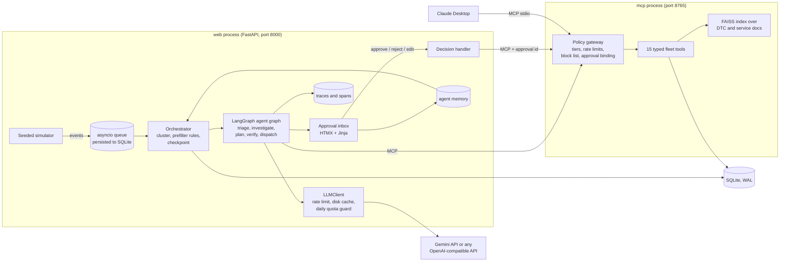

# Haulmind

Haulmind is an autonomous operations agent for fleet managers. It watches a telematics event
stream (GPS, hours-of-service clocks, fault codes, engine metrics, fuel-card transactions),
decides which clusters of events are worth attention, investigates them on its own through a
set of typed fleet tools, and produces a short inbox of investigated actions. Low-risk steps
run automatically, medium-risk steps wait for a one-click approval, and high-risk steps are
recommendations only. Everything in this repository is synthetic: a seedable simulator
generates the fleet, the events and labeled ground-truth incidents, so the agent can be
scored, not just demonstrated.

> Runs locally in a few minutes. No Docker, no external services, no paid APIs: Python 3.11,
> `uv`, SQLite, and optionally one free API key: Gemini from Google AI Studio, or Groq (or any
> other OpenAI-compatible service). Without a key the whole system (demo, tests, evals) runs
> on a deterministic offline stand-in for the model.

## Architecture



Two processes. The web process owns the in-process event queue, the simulator producer, the
orchestrator consumer, the agent graph and the UI. The MCP server process owns the fleet tools
and the policy gateway; agents reach it over streamable HTTP, and Claude Desktop can attach to
the same server over stdio. Tests and evals connect the same `MCPServer` in-process so they
are fast and need no network.

## Quickstart

Requirements: Python 3.11 or newer, [uv](https://docs.astral.sh/uv/), GNU make (optional,
every target is a plain `uv run` command you can copy).

```bash
git clone <this repo> && cd haulmind
cp .env.example .env            # optional: a free Gemini key (aistudio.google.com/apikey) or Groq key (console.groq.com)
make setup                      # uv sync, alembic migrations, FAISS index
make run                        # MCP server + web app (UI, event bus, simulator, agents)
```

Open <http://127.0.0.1:8000/inbox>. The default run streams 25 trucks for 48 simulated hours
at two simulated minutes per real second; change the speed from the status bar.

Other entry points:

| Command | What it does |
|---|---|
| `make demo` | 8 trucks, 20 simulated hours, 10 sim-minutes per second, opens the inbox. See `docs/demo-script.md`. |
| `make eval` | Full evaluation against ground truth, writes `evals/results.md` and refreshes the table below. |
| `make eval-replay` | Same, but every model call must come from the disk cache (zero network calls). |
| `make test`, `make lint`, `make typecheck` | pytest, ruff, mypy (strict). |
| `make models` | Lists the models your key can reach (Gemini or the OpenAI-compatible provider) and checks the configured names. |
| `make sim` | Generates a seeded run and prints its ground truth without streaming. |
| `make reset` | Deletes the SQLite database and run folders (keeps the LLM cache). |

## What happens to an event

1. The simulator pushes a typed event onto the bus; the bus persists it and projects it onto
   the fleet-state tables (vehicle position, HOS clocks, fault codes, fuel transactions).
2. The orchestrator groups events into clusters per driver or vehicle and domain, and runs
   **rule prefilters**. More than 95% of events stop here, with no model involved.
3. Candidates go to the LangGraph graph. Clear-cut clusters skip triage; ambiguous ones get one
   compact **triage** call on the cheapest model.
4. The domain **investigator** (safety, maintenance, compliance, spend) gathers evidence through
   the MCP tools: scripted calls first, then one function-calling round in which the model may
   request up to two more tools.
5. The **planner** proposes zero to three actions as schema-validated JSON with reasoning,
   evidence references and confidence. The **verifier** checks them against the evidence and
   policy in code, then with one more model call.
6. **Dispatch** executes tier-1 actions through the MCP gateway, queues tier-2 actions for
   approval, records tier-3 actions as recommendations, and writes audit entries and a trace.

## Autonomy tiers

The tier of every tool lives in one table (`haulmind/policy/tiers.py`) and is enforced inside
the MCP server's tool handlers, not in prompts. A prompt-injected or buggy agent hits exactly
the same gate as Claude Desktop would.

| Tier | Behaviour | Tools |
|---|---|---|
| 0 | Read-only | `get_vehicle_status`, `get_driver_hos`, `find_idle_vehicles`, `list_hos_risks`, `get_fault_history`, `search_fault_docs`, `find_nearby_shops`, `get_fuel_transactions`, `get_recent_events` |
| 1 | Runs automatically, rate limited, block-listed | `message_driver`, `flag_fuel_transaction` |
| 2 | Queued until a manager approves; the approval is bound to a hash of the exact arguments and is single-use | `create_work_order`, `propose_reassignment` |
| 3 | Recommendation only, never executed by the system | `suspend_fuel_card`, `set_vehicle_out_of_service` |

Hard rules that no approval can override: forbidden phrases and links in driver messages
(HR/legal language, prompt-injection echoes), a 15,000 USD cap on work orders, id validation,
and sliding-window rate limits per tool and per driver. `tests/test_policy.py` and
`tests/test_mcp_tools.py` show an agent trying to escalate and failing every time.

## Learning from manager decisions

Approve, reject and edit decisions are stored per driver and per vehicle. Rejections carry a
reason code, and the learning rules turn them into tuned thresholds: an HOS near-miss rejected
with "driver manages the clock" lowers that driver's alert margin and, after repeated
rejections across drivers, the fleet-wide default; a work order rejected as "known
intermittent" adds the fault codes to that vehicle's nuisance list; a fuel flag rejected as
legitimate marks combined tractor-and-reefer fills as expected. The prefilter and the prompts
read this memory on every cluster, and the evaluation measures its effect.

<!-- EVAL_RESULTS_START -->
## Evaluation results

Generated by `make eval` on 2026-10-09 17:46 (Windows, Python 3.11.0). LLM provider: **stub** (deterministic offline heuristics; set GEMINI_API_KEY to evaluate the real model). Cache mode: `live`.

Base scenario: seed 42, 25 trucks, 48 simulated hours, 8727 events, 8 injected incidents and 6 benign look-alikes. Wall time 44s, 47 MCP tool calls.

### Core metrics

| Run | Detection recall | False-alert rate | Action correctness | Policy violations | Latency p50 / p95 | LLM requests / tokens per incident | Events filtered before any LLM |
|---|---|---|---|---|---|---|---|
| multi-agent, RAG, memory (base) | 100% (8/8) | 20% (2/10) | 100% | 0 | 48 / 482 ms | 3.5 / 2367 | 99.8% |

Per scenario type (base run):

| Type | Injected | Detected | Expected actions proposed |
|---|---|---|---|
| failing_component | 2 | 2 | 2 |
| fuel_fraud | 2 | 2 | 2 |
| harsh_driving_pattern | 1 | 1 | 1 |
| hos_violation_risk | 3 | 3 | 3 |

False alerts: INC-5d3de519 failing_component V-01; INC-43265a65 hos_violation_risk V-23.

### Learning loop: precision before vs after manager decisions

Scenario: 25 trucks, 72 simulated hours with extra benign look-alikes (5 HOS near misses, 2 nuisance-code trucks, 1 reefer unit). At the end of each simulated day a scripted manager reviews the inbox: approves actions on real incidents, rejects look-alikes with a reason code. With memory on, those decisions tune per-driver/per-vehicle thresholds before the next day streams; with memory off they are recorded but ignored.

| Day | Memory | Alerts | True | False | Precision | Recall |
|---|---|---|---|---|---|---|
| day 1 (no decisions yet) | on | 4 | 2 | 2 | 50% | 100% |
| day 2 | on | 3 | 3 | 0 | 100% | 75% |
| day 3 | on | 6 | 2 | 4 | 33% | 100% |
| day 1 (no decisions yet) | off | 4 | 2 | 2 | 50% | 100% |
| day 2 | off | 4 | 3 | 1 | 75% | 75% |
| day 3 | off | 8 | 2 | 6 | 25% | 100% |

Manager decisions simulated per arm: 9.

### Ablations

| Run | Detection recall | False-alert rate | Action correctness | Policy violations | Latency p50 / p95 | LLM requests / tokens per incident | Events filtered before any LLM |
|---|---|---|---|---|---|---|---|
| multi-agent, RAG, memory (base) | 100% (8/8) | 20% (2/10) | 100% | 0 | 48 / 482 ms | 3.5 / 2367 | 99.8% |
| single agent (one LLM call), RAG, memory | 100% (8/8) | 20% (2/10) | 100% | 0 | 51 / 126 ms | 1.0 / 715 | 99.8% |
| multi-agent, no RAG, memory | 100% (8/8) | 20% (2/10) | 100% | 0 | 52 / 220 ms | 3.5 / 2250 | 99.8% |

- Flash-Lite vs Flash planner ablation skipped: no GEMINI_API_KEY, both roles ran on the offline stub.

Definitions: an *alert* is an incident with at least one action proposed to a manager or executed automatically; *false-alert rate* is the share of alerts that match no injected incident; *action correctness* is the share of detected incidents whose proposed actions include every expected action; *policy violations* counts tier-2/3 side effects without a bound approval (must be 0). Latency is wall time per incident trace. Tokens are prompt plus output per incident.

<!-- EVAL_RESULTS_END -->

### Known failures and honest notes

- Every number above comes from the offline stub provider: no Gemini key was available while
  this was built. The harness, cache and replay mode are ready; `make eval` with a key in
  `.env` regenerates the block with real model behaviour, and `make eval-replay` reproduces it
  afterwards with zero network calls.
- The two base-run false alerts are both labeled look-alikes. One is an HOS near miss (the
  driver arrives with about ten minutes of drive time left; the heuristic triage alerts at
  margins up to ten minutes). One is a transient fault code that happened to recur within
  48 hours on the same truck. Both are exactly the cases the learning loop is built to absorb
  after a manager rejection.
- Learning-loop day 3 still shows four false alerts with memory on: the two designed
  nuisance-code trucks (a low-severity code recurring daily, escalated on its third day per the
  service guidance and learned only after that rejection) and chance noise recurrences on trucks
  the manager had not yet given feedback about. The improvement over the memory-off control is
  real but small on three simulated days.
- Harsh-driving patterns need at least four events across two trips. The 24-hour `--quick`
  scenario misses the injected pattern because it spans two days.
- Under the stub, the ablations are flat on recall and false alerts (the heuristics do not use
  the retrieved documents, and the single-agent path reuses the same rules). What changes is
  cost: one model call and about 700 tokens per incident versus 3.5 calls and about 2,400
  tokens. The Flash-Lite versus Flash planner comparison requires a key and is skipped.
- Latency figures are stub latencies. With Gemini on the free tier, each incident costs three
  to four sequential model calls at five requests per minute, so expect roughly 30 to 60
  seconds per incident and plan a full 25-truck, 48-hour evaluation at a few hundred requests.

## Design decisions and tradeoffs

- **Rules before models.** Free-tier quotas (a handful of requests per minute, a few hundred a
  day) make every model call a budget decision. Deterministic prefilters drop telemetry noise,
  definite cases skip triage, scripted evidence gathering replaces most tool-calling rounds,
  and prompts carry compact summaries instead of raw tool output.
- **Policy in code, in the server.** Tiers, rate limits, the block list and approval binding
  live in the MCP server's tool handlers. The agent's dispatch step consults the same table,
  but even if it did not, the gateway would still refuse.
- **Approvals bound to arguments.** An approval stores a hash of the canonical tool arguments
  (defaults filled in). Editing an action re-binds it; replaying an approval fails; using it for
  another tool fails.
- **One LLM interface, four clients.** Gemini via `google-genai` with native function calling
  and `response_json_schema`; any OpenAI-compatible endpoint (Groq, Mistral, OpenRouter, Ollama)
  via plain `httpx` with the same tool-call and JSON-schema handling; a disk cache keyed by the
  full request; and an offline stub that applies transparent heuristics to the same structured
  payloads. The stub makes the project runnable and testable without a key; results produced
  by it are labeled as such, and every trace and eval table names the provider.
- **Hashed embeddings instead of a neural embedder.** The corpus is a few dozen fault-code and
  service-guidance documents where codes and component names dominate. TF-IDF-weighted feature
  hashing into 512 dimensions on a FAISS inner-product index retrieves them well, costs
  nothing, and keeps memory use negligible. A Gemini embedding backend fits behind the same
  interface.
- **Simulated time everywhere.** Rate-limit windows, HOS clocks and "nearby" queries use the
  simulated clock, so a 48-hour run can replay in a minute without breaking the policy.
- **SQLite for everything.** Events, fleet state, incidents, actions, approvals, audit log,
  memory and traces share one WAL-mode database file. Replay is a query by run id and sequence.
- **Synchronous SQLAlchemy inside async code.** Transactions are tiny and local; the
  simplicity was worth more than an async driver.

## Model providers and free-tier handling

Two live providers sit behind the same `LLMClient` interface, chosen by `LLM_PROVIDER`
(`auto` picks Gemini when `GEMINI_API_KEY` is set, else the OpenAI-compatible provider when
`LLM_API_KEY` is set, else the stub):

- **Gemini** via `google-genai`. As of October 2026 the free tier allows only 20 requests per
  day on the 3.x Flash models, which is less than one incident's worth of investigation;
  `gemini-3.5-flash-lite` has a few hundred and is the practical free choice for both roles.
- **Any OpenAI-compatible API** via `LLM_API_BASE` and `LLM_API_KEY`: Groq (free tier, no
  card, about a thousand requests a day on `openai/gpt-oss-120b`), Mistral,
  OpenRouter, Ollama for fully local models, and others. Set `LLM_MODEL_TRIAGE` and
  `LLM_MODEL_PLANNER` to names the provider serves; `make models` lists them, and startup
  fails fast if a configured name is not served. Providers that reject JSON-schema response
  formats automatically fall back to JSON mode with the schema in the system prompt.

The free-tier plumbing is shared by both:

- Central async rate limiter per model (default 5 requests per minute), exponential backoff
  with jitter on 429 or `RESOURCE_EXHAUSTED`, and a daily request budget per model persisted in
  `data/quota.json`. When the daily budget is gone the orchestrator checkpoints the last
  processed event and stops cleanly; the next start resumes from the checkpoint.
- Disk cache keyed by hash of model, system prompt, messages, tool schemas and parameters.
  `LLM_CACHE_MODE=replay` turns a cache miss into an error, which is how `make eval-replay`
  proves zero network calls.
- Model names are configuration (`LLM_MODEL_TRIAGE`, `LLM_MODEL_PLANNER`), defaulting to
  `gemini-3.5-flash-lite` and `gemini-3.5-flash`; `make models` lists what your key can reach.
- Cost is reported as tokens and requests per incident; the dollar cost on the free tier is 0.

## Connect Claude Desktop to the MCP server

Add this to Claude Desktop's `claude_desktop_config.json` (adjust the path), restart Claude
Desktop, and ask it things like "Which drivers are close to running out of drive time?" or
"Open a work order for V-01's cooling system":

```json
{
  "mcpServers": {
    "haulmind-fleet": {
      "command": "uv",
      "args": ["run", "--directory", "C:/path/to/haulmind", "python", "-m", "haulmind.mcp_server", "--transport", "stdio"]
    }
  }
}
```

Run `make run` (or `make sim`) first so the database holds a fleet. Claude can read anything,
send rate-limited messages and flag transactions, but a work order it requests lands in the
Haulmind inbox as "pending approval" and a request to ground a truck becomes a recommendation.
The same gateway, the same audit log.

## Limitations

- The simulator is a caricature of real telematics: straight-line routes, idealized HOS
  bookkeeping, a small catalogue of fault codes and service documents.
- Without an API key the agent's judgment comes from the offline stub's heuristics; the eval
  table says which provider produced its numbers. Live-model numbers depend on the free tier's
  limits on the day you run them.
- One active run at a time; installing a new run resets fleet state and agent memory because
  the synthetic ids are reused.
- The agent graph writes its own outputs (incidents, proposed actions, traces) directly to the
  database; only fleet data access goes through MCP. The trust boundary is the process, not
  the agent.
- No authentication on the web UI or the MCP server; both bind to localhost.

## Repository layout

```
haulmind/            package: config, db, events, simulator, mcp_server, policy, rag, llm,
                     agents, tracing, web, orchestrator, demo
evals/               run_eval.py, metrics.py, manager_sim.py, results.md
tests/               pytest suites (policy, MCP tools, prefilter, simulator, pipeline, llm/rag)
docs/                demo-script.md
PLAN.md              architecture, data model, milestones, assumptions
```
